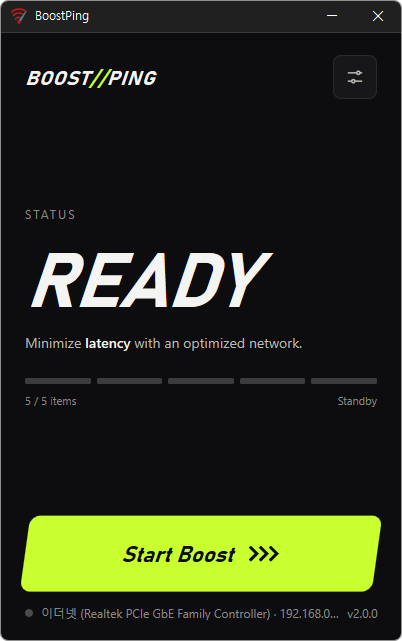

# BoostPing

**ボタンひとつで Windows のネットワーク設定をゲーム向けに切り替え、オンラインゲームの反応速度を高める無料ツール。**

[English](README.md) · [한국어](README.ko.md) · [简体中文](README.zh-CN.md) · 日本語 · [Español](README.es.md) · [Português (Brasil)](README.pt-BR.md) · [Français](README.fr.md)

> この文書は翻訳版です。内容に違いがある場合は[韓国語版](README.ko.md)が基準となります。

-0078D4)

## 概要

Windows は標準で、ネットワークのデータを少しずつためてからまとめて送るように設定されています。ファイルのダウンロードや Web 閲覧には効率的ですが、キー入力のひとつひとつがすぐにサーバーへ届く必要があるオンラインゲームでは、その分だけ反応が遅れます。

BoostPing は、こうした設定 5 つをゲーム向けに切り替えます。**[ブースト開始]** を押すと、いまインターネットにつながっているネットワークを見つけて設定を適用し、ネットワークを再接続します。**[ブースト停止]** を押すと、適用前の元の値に正確に戻します。変更する項目は自分で選べ、選ばなかった項目には一切触れません。

## 主な機能

- **ボタンひとつで適用** — 面倒な設定は不要。[ブースト開始] を一度押すだけです。
- **使用中のネットワークを自動で検出** — 実際にインターネットにつながっているアダプターを選び、画面下部に名前と IP を表示します。仮想ネットワークアダプターはスキップします。
- **5 つの項目を選んで適用** — ACK 即時応答、ACK 遅延なし、Nagle アルゴリズムを無効化、ネットワーク制限を解除、ゲームを優先処理。
- **元どおりに正確に復元** — 適用前の値を覚えておき、停止するとそのまま元に戻します。もともと存在しなかった設定は削除し、自分で変更していた値はその値に戻ります。
- **閉じても効果が続く** — 設定は Windows に適用されるため、ウィンドウを閉じても再起動しても効果は続きます。再び起動すると適用状態をそのまま表示します。
- **9 言語** — 韓国語・英語・日本語・中国語・ロシア語・イタリア語・フランス語・アラビア語・スペイン語。Windows の表示言語に従います。

## ダウンロード / インストール

| 種類 | リンク |
|---|---|
| インストーラー | [ダウンロード](https://down.kilho.net/boostping?lang=ja) |
| ポータブル (ZIP) | [ダウンロード](https://down.kilho.net/boostping?lang=ja&nosetup) |

インストーラー版はインストールが終わるとすぐに起動します。ポータブル版は ZIP を展開して `BoostPing.exe` を実行するだけです。どちらも**管理者権限**を求めます。

## 使い方

### はじめて使う

1. BoostPing を起動します。Windows の設定を変更するプログラムなので、管理者権限の確認画面が出たら **[はい]** を押します。
2. 画面の一番下に、使用中のネットワークの名前と IP が表示されていることを確認します。(例: `イーサネット (Realtek PCIe GbE Family Controller) · 192.168.0.10`)
3. 変更する項目を選ぶには、右上の**設定アイコン**を押して **TUNING** 画面を開きます。最初は 5 つすべてがオンです。
4. **[ブースト開始]** を押します。状態が **BOOST** に変わり、「ネットワークを再接続しています…」と表示されます。このとき、インターネットが一瞬切れてから再接続されます。
5. インターネットが再接続されると、状態が **ON**、「最適化が適用されました」に変わります。あとはゲームを起動するだけです。
6. 元に戻したいときは **[ブースト停止]** を押します。ネットワークをもう一度再接続し、**READY** に戻ります。

### 画面構成

**メイン画面**

| 要素 | 説明 |
|---|---|
| **BOOST//PING** ロゴ | 押すと BoostPing のホームページが開きます |
| 設定アイコン (右上) | TUNING 画面へ移動 |
| **STATUS** | **READY** = 待機、**BOOST** = 適用中、**ON** = 適用済み |
| 5 本のバー · **%d / 5 項目** | オンにしている項目の数。バー 1 本が項目 1 つです |
| **[ブースト開始]** / **[ブースト停止]** | 適用する / 元に戻す |
| 一番下の行 | 使用中のネットワーク名 · IP、プログラムのバージョン |

**TUNING 画面** — 項目を押してオン・オフを切り替えます。変更はすぐに保存されます。

| 項目 | 内容 |
|---|---|
| **ACK 即時応答** | 受信確認をまとめずにすぐ送ります |
| **ACK 遅延なし** | 確認遅延タイマーを 0 にします |
| **Nagle アルゴリズムを無効化** | 小さなパケットをまとめずにすぐ送信します |
| **ネットワーク制限を解除** | メディア再生中の転送制限を解除します |
| **ゲームを優先処理** | バックグラウンド用の CPU 予約をなくします |

### こんなときは

**ゲーム中の入力がワンテンポ遅れて感じるとき**
ゲームを起動する前に、BoostPing で [ブースト開始] を押してください。小さなデータを頻繁にやり取りするオンラインゲームほど効果を感じやすくなります。適用時にインターネットが一瞬再接続されるので、対戦に入る**前に**オンにしておくのがおすすめです。

**一度オンにしたらそのまま使いたいとき**
ブーストをオンにした後は、BoostPing のウィンドウを閉じてもかまいません。設定は Windows に残っているので、再起動後も適用されたままです。BoostPing を再び起動すると、状態は **ON** と表示されます。

**音楽や配信を流しながらゲームするとき**
Windows はメディアを再生している間、ネットワークの転送を制限します。**ネットワーク制限を解除** をオンにしておけば、音楽や動画を流したままでもこの制限はかかりません。

**一部の項目だけ適用したいとき**
ブーストがオフ (READY) の状態で、設定アイコン → TUNING 画面から不要な項目を押してオフにします。メイン画面のバーと **%d / 5 項目** がすぐに変わります。オフにした項目は、開始時にも停止時にも一切触れません。

**ブーストがオンのまま項目を変えたいとき**
オンの間は TUNING 画面がロックされ、「ブーストを停止してから変更できます。」と表示されます。[ブースト停止] → 項目を変更 → [ブースト開始] の順に操作してください。

**効果を比べてみたいとき**
[ブースト停止] で元の状態のまま 1 回、[ブースト開始] で適用した状態で 1 回プレイしてみてください。停止すると適用前の値に正確に戻るので、何度でも切り替えて比べられます。

**以前に自分でネットワーク設定を変えたことがあるとき**
BoostPing は開始前に現在の値を覚えておきます。停止すると Windows の既定値ではなく、**自分で設定していたその値**に戻ります。

**ノートパソコンで Wi‑Fi と有線を切り替えて使うとき**
ブーストは、開始したときに使っていたネットワークに適用されます。別のネットワークに切り替えたら、[ブースト停止] を押してから BoostPing を閉じ、もう一度起動してください。画面下部に新しいネットワークが表示されたら [ブースト開始] を押します。停止するときは、途中でネットワークを切り替えていても、最初に適用したネットワークを元に戻します。

**遊び終わって元に戻したいとき**
BoostPing を起動して [ブースト停止] を押すだけです。プログラムをアンインストールする前にも、先にブーストをオフにしておいてください。

**BoostPing のウィンドウが見当たらないとき**
BoostPing は同時にひとつしか起動しません。起動中にもう一度実行すると、先に開いていたウィンドウが前面に出ます(最小化されていた場合は元のサイズに戻ります)。

## 設定

TUNING 画面で変更し、変更はすぐに保存されます。アップデートしても保持されます。

| 項目 | 既定値 |
|---|---|
| ACK 即時応答 | オン |
| ACK 遅延なし | オン |
| Nagle アルゴリズムを無効化 | オン |
| ネットワーク制限を解除 | オン |
| ゲームを優先処理 | オン |

画面の言語は Windows の表示言語に従います(韓国語・英語・日本語・中国語・ロシア語・イタリア語・フランス語・アラビア語・スペイン語、それ以外は英語)。アラビア語は右から左に表示されます。

## 動作環境

- Windows 10 · Windows 11 (64 ビット)
- 管理者権限 — Windows のネットワーク設定を変更するため、起動時に権限の確認画面が表示されます。
- 追加のランタイムは不要です。

## アップデート

BoostPing は自動的にはアップデート**しません**。起動時に新バージョンの有無を確認して案内画面を表示し、**[はい]** を押すとダウンロードページが開いてプログラムが終了します。新バージョンは内部検証の後に手動で配布され、[BoostPing ページ](https://kilho.net/boostping)で告知されます。[アップデートポリシー](https://en.kilho.net/archives/notice/2940)をご覧ください。

## ライセンス

BoostPing は**フリーウェア**です。会社、自宅、官公庁、学校など場所を問わず無料で使え、自由に再配布できます。

## リンク

- Web サイト: <https://kilho.net/boostping>
- フォーラム: <https://kilho.top/forum/qna>
- X (Twitter): <https://www.twitter.com/kilhonet>

© KILHO.NET
