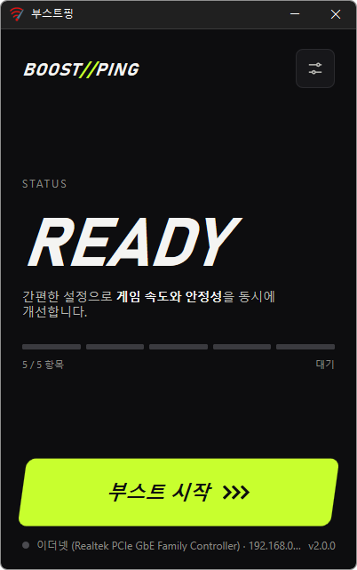

# 부스트핑

**버튼 하나로 Windows 네트워크 설정을 게임에 맞게 바꿔 온라인 게임의 반응 속도를 높여 주는 무료 프로그램.**

[English](README.md) · 한국어 · [简体中文](README.zh-CN.md) · [日本語](README.ja.md) · [Español](README.es.md) · [Português (Brasil)](README.pt-BR.md) · [Français](README.fr.md)

-0078D4)

## 개요

Windows 는 기본적으로 네트워크 데이터를 조금씩 모았다가 한꺼번에 보내도록 맞춰져 있습니다. 파일을 받거나 웹을 볼 때는 효율적이지만, 키 입력 하나하나가 곧바로 서버에 닿아야 하는 온라인 게임에서는 그만큼 반응이 늦어집니다.

부스트핑은 이런 설정 5가지를 게임에 맞게 바꿔 줍니다. **[부스트 시작]** 을 누르면 지금 인터넷에 연결된 네트워크를 찾아 설정을 적용하고 네트워크를 다시 연결합니다. **[부스트 끄기]** 를 누르면 적용하기 전의 원래 값으로 정확히 되돌립니다. 바꿀 항목은 직접 고를 수 있고, 고르지 않은 항목은 건드리지 않습니다.

## 주요 기능

- **버튼 하나로 적용** — 복잡한 설정 없이 [부스트 시작] 한 번이면 끝납니다.
- **지금 쓰는 네트워크를 자동으로 찾기** — 실제 인터넷에 연결된 어댑터를 골라 화면 아래에 이름과 IP 를 보여 줍니다. 가상 네트워크 어댑터는 건너뜁니다.
- **항목 5가지를 골라서 적용** — ACK 즉시 응답, ACK 지연 없음, 네이글 알고리즘 끄기, 네트워크 제한 해제, 게임 우선 처리.
- **원래대로 정확히 복원** — 적용하기 전의 값을 기억해 두었다가 끌 때 그대로 돌려놓습니다. 원래 없던 설정은 지우고, 직접 바꿔 두었던 값은 그 값으로 돌아갑니다.
- **프로그램을 닫아도 유지** — 설정은 Windows 에 적용되므로 창을 닫거나 재부팅해도 효과가 이어집니다. 다시 실행하면 적용 상태를 그대로 보여 줍니다.
- **9개 언어** — 한국어 · 영어 · 일본어 · 중국어 · 러시아어 · 이탈리아어 · 프랑스어 · 아랍어 · 스페인어. Windows 표시 언어를 따릅니다.

## 다운로드 / 설치

| 구분 | 링크 |
|---|---|
| 설치 파일 | [다운로드](https://down.kilho.net/boostping?lang=ko) |
| 무설치 (ZIP) | [다운로드](https://down.kilho.net/boostping?lang=ko&nosetup) |

설치판은 설치가 끝나면 바로 실행됩니다. 무설치판은 ZIP 을 풀고 `BoostPing.exe` 를 실행하면 됩니다. 어느 쪽이든 **관리자 권한**을 요청합니다.

## 사용법

### 처음 사용하기

1. 부스트핑을 실행합니다. Windows 설정을 바꾸는 프로그램이라 관리자 권한 확인 창이 뜨면 **[예]** 를 누릅니다.
2. 화면 맨 아래에 지금 쓰는 네트워크의 이름과 IP 가 보이는지 확인합니다. (예: `이더넷 (Realtek PCIe GbE Family Controller) · 192.168.0.10`)
3. 바꿀 항목을 고르려면 오른쪽 위 **설정 아이콘**을 눌러 **TUNING** 화면으로 갑니다. 처음에는 5가지 모두 켜져 있습니다.
4. **[부스트 시작]** 을 누릅니다. 상태가 **BOOST** 로 바뀌고 "네트워크를 다시 연결하는 중…" 이 표시됩니다. 이때 인터넷이 잠깐 끊겼다 다시 연결됩니다.
5. 인터넷이 다시 연결되면 상태가 **ON**, "최적화가 적용되었습니다" 로 바뀝니다. 이제 게임을 실행하면 됩니다.
6. 원래대로 돌리고 싶으면 **[부스트 끄기]** 를 누릅니다. 네트워크를 한 번 더 다시 연결하고 **READY** 로 돌아갑니다.

### 화면 구성

**처음 화면**

| 요소 | 설명 |
|---|---|
| **BOOST//PING** 로고 | 누르면 부스트핑 홈페이지가 열립니다 |
| 설정 아이콘 (오른쪽 위) | TUNING 화면으로 이동 |
| **STATUS** | **READY** = 대기, **BOOST** = 적용 중, **ON** = 적용됨 |
| 막대 5개 · **%d / 5 항목** | 켜 둔 항목 수. 막대 하나가 항목 하나입니다 |
| **[부스트 시작]** / **[부스트 끄기]** | 적용하기 / 원래대로 돌리기 |
| 맨 아래 줄 | 지금 쓰는 네트워크 이름 · IP, 프로그램 버전 |

**TUNING 화면** — 항목을 눌러 켜고 끕니다. 바꾸는 즉시 저장됩니다.

| 항목 | 하는 일 |
|---|---|
| **ACK 즉시 응답** | 받은 데이터의 확인을 모으지 않고 바로 보냅니다 |
| **ACK 지연 없음** | 확인 지연 타이머를 0 으로 둡니다 |
| **네이글 알고리즘 끄기** | 작은 패킷을 묶지 않고 곧바로 전송합니다 |
| **네트워크 제한 해제** | 미디어 재생 중 걸리는 전송 제한을 풉니다 |
| **게임 우선 처리** | 백그라운드에 떼어 두는 CPU 몫을 없앱니다 |

### 이럴 때 이렇게

**게임 중 입력이 한 박자 늦게 느껴질 때**
게임을 켜기 전에 부스트핑에서 [부스트 시작] 을 누르세요. 작은 데이터를 자주 주고받는 온라인 게임일수록 효과를 느끼기 쉽습니다. 적용할 때 인터넷이 잠깐 다시 연결되므로 게임에 들어가기 **전에** 켜 두는 것이 좋습니다.

**한 번 켜 두고 계속 쓰고 싶을 때**
부스트를 켠 뒤에는 부스트핑 창을 닫아도 됩니다. 설정은 Windows 에 남아 있어서 재부팅한 뒤에도 그대로 적용된 상태입니다. 부스트핑을 다시 실행하면 상태가 **ON** 으로 보입니다.

**음악이나 방송을 틀어 놓고 게임할 때**
Windows 는 미디어를 재생하는 동안 네트워크 전송을 제한합니다. **네트워크 제한 해제** 를 켜 두면 음악·영상을 틀어 둔 채로도 이 제한이 걸리지 않습니다.

**일부 항목만 적용하고 싶을 때**
부스트가 꺼진 상태(READY)에서 설정 아이콘 → TUNING 화면에서 원하지 않는 항목을 눌러 끕니다. 처음 화면의 막대와 **%d / 5 항목** 이 바로 바뀝니다. 꺼 둔 항목은 시작할 때도 끌 때도 전혀 건드리지 않습니다.

**부스트가 켜진 상태에서 항목을 바꾸고 싶을 때**
켜져 있는 동안에는 TUNING 화면이 잠겨 "부스트를 끈 뒤에 바꿀 수 있습니다." 라고 표시됩니다. [부스트 끄기] → 항목 변경 → [부스트 시작] 순서로 하세요.

**효과를 비교해 보고 싶을 때**
[부스트 끄기] 로 원래 상태에서 한 판, [부스트 시작] 으로 적용한 상태에서 한 판 해 보세요. 끄면 적용하기 전의 값으로 정확히 돌아가므로 몇 번이든 번갈아 비교할 수 있습니다.

**전에 직접 네트워크 설정을 바꿔 둔 적이 있을 때**
부스트핑은 시작하기 전에 지금 값을 기억해 둡니다. 끄면 Windows 기본값이 아니라 **직접 바꿔 두었던 그 값**으로 돌아갑니다.

**노트북에서 Wi-Fi 와 유선을 바꿔 쓸 때**
부스트는 시작할 때 쓰던 네트워크에 적용됩니다. 다른 네트워크로 바꿨다면 [부스트 끄기] 를 누른 뒤 부스트핑을 닫고 다시 실행하세요. 화면 아래에 새 네트워크가 보이면 [부스트 시작] 을 누릅니다. 끌 때는 네트워크를 바꿨더라도 처음 적용했던 네트워크를 원래대로 되돌립니다.

**게임을 다 하고 원래대로 돌리고 싶을 때**
부스트핑을 실행해 [부스트 끄기] 를 누르면 됩니다. 프로그램을 제거하기 전에도 먼저 부스트를 꺼 두세요.

**부스트핑 창이 안 보일 때**
부스트핑은 한 번에 하나만 실행됩니다. 이미 실행 중일 때 다시 실행하면 먼저 떠 있던 창이 앞으로 나옵니다(최소화되어 있었으면 다시 펼쳐집니다).

## 설정

TUNING 화면에서 바꾸며, 바꾸는 즉시 저장됩니다. 업데이트해도 유지됩니다.

| 항목 | 기본값 |
|---|---|
| ACK 즉시 응답 | 켜짐 |
| ACK 지연 없음 | 켜짐 |
| 네이글 알고리즘 끄기 | 켜짐 |
| 네트워크 제한 해제 | 켜짐 |
| 게임 우선 처리 | 켜짐 |

화면 언어는 Windows 표시 언어를 따릅니다(한국어 · 영어 · 일본어 · 중국어 · 러시아어 · 이탈리아어 · 프랑스어 · 아랍어 · 스페인어, 그 외는 영어). 아랍어는 오른쪽에서 왼쪽으로 표시됩니다.

## 요구 사항

- Windows 10 · Windows 11 (64비트)
- 관리자 권한 — Windows 네트워크 설정을 바꾸기 때문에 실행할 때 권한 확인 창이 뜹니다.
- 별도 런타임이 필요 없습니다.

## 업데이트

부스트핑은 자동으로 업데이트하지 **않습니다**. 실행할 때 새 버전이 있는지 확인해 안내 창을 띄우고, **[예]** 를 누르면 다운로드 페이지가 열리면서 프로그램이 종료됩니다. 새 버전은 내부 검증 후 수동으로 배포되고 [부스트핑 페이지](https://kilho.net/boostping)에 공지됩니다. [업데이트 정책 안내](https://kilho.net/archives/notice/2940)를 참고하세요.

## 라이선스

부스트핑은 **프리웨어**입니다. 회사, 집, 관공서, 학교 어디서나 제약 없이 무료로 쓸 수 있고, 자유롭게 재배포할 수 있습니다.

## 링크

- 웹사이트: <https://kilho.net/boostping>
- 포럼: <https://kilho.top/forum/qna>
- X (Twitter): <https://www.twitter.com/kilhonet>

© KILHO.NET
